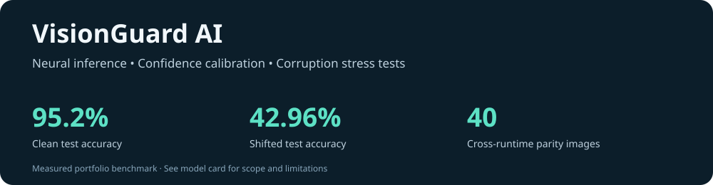

# VisionGuard AI

**A small neural vision system that shows its mistakes, confidence and limits.**

An AI-assisted portfolio implementation by **Vikas Reddy Konreddy**.



Neural networks · temperature scaling · selective classification · robustness · browser inference

## The engineering question

Can a classifier identify when it should abstain—and does that still work when
the input changes? VisionGuard trains a 64→64→32→10 neural network on the small
UCI optical-digits benchmark bundled with scikit-learn, compares it with logistic
regression, calibrates confidence, and stress-tests clean images, noise,
occlusion and a one-pixel shift. It includes actual browser inference from
exported weights, not a mock prediction UI.

## Measured results

| Held-out test condition | Accuracy | Accepted coverage | Accuracy on accepted images |
|---|---:|---:|---:|
| Clean | 95.19% | 94.44% | 96.47% |
| Gaussian noise (σ=0.25) | 86.30% | 90.74% | 92.65% |
| Two middle rows masked | 46.30% | 83.70% | 48.67% |
| One-pixel right shift | 42.96% | 84.44% | 45.61% |

The clean logistic-regression baseline also reached 95.19% accuracy. The neural
model did **not** outperform it on that metric. The validation threshold met a
98% accepted-accuracy target on validation, but achieved only 96.47% on accepted
clean test images. Under occlusion/shift it remained confidently wrong on many
images. That failure is a central result, not hidden behind the clean score.

[Raw metrics and confusion matrix](reports/metrics.json) · [Model card](MODEL_CARD.md)

## Run locally

Python 3.12 and Node 22 are used in CI. No API key, GPU or model download.

```bash
python -m venv .venv
source .venv/bin/activate  # Windows: .venv\Scripts\activate
pip install -r requirements.txt
python -m visionguard.pipeline
python -m unittest discover -s tests -v
python build_report.py
node tests/parity.cjs
python -m http.server 8031 --bind 127.0.0.1
```

Open **http://127.0.0.1:8031**. Select held-out samples, mask or shift them, inspect
the ten probabilities, or clear the pixel grid and draw a custom digit. Browser
inference uses JSON weights and standard JavaScript; the drawing stays local.
Custom drawings are outside the evaluated distribution and may be misclassified.
The committed report is ready to serve without retraining.

## Reproducible workflow

1. Stratify 1,797 labelled 8×8 images into four disjoint partitions:
   1,078 training / 269 calibration / 180 validation / 270 test.
2. Scale pixel intensities by the known dataset maximum of 16. Train a ReLU MLP
   with early stopping entirely inside the training partition. Fit a logistic
   baseline on the same training images.
3. Fit a single temperature on calibration negative log likelihood.
4. On validation, choose the lowest confidence cutoff reaching ≥98% accepted
   accuracy with at least 30 accepted examples. If none qualifies, abstain on all.
5. Freeze temperature/cutoff. Evaluate clean and corrupted test data, confusion
   matrix, log loss and descriptive risk/coverage curves. Never retune on test.
6. Export weights and verify independent NumPy forward propagation against
   scikit-learn. Compare JavaScript confidence/predictions against Python on
   40 held-out images with tolerance 1e-10.

The network architecture and hyperparameters are fixed for this project. This
is one split, without repeated-seed or confidence-interval analysis. Random
splitting is not writer-disjoint because writer IDs are not available in the
bundled arrays. Results do not establish generalisation to unseen writers.

## What this demonstrates

- Neural forward propagation, stable softmax and multiclass evaluation.
- Separate data for fitting, calibration, threshold selection and final testing.
- Selective prediction with explicit coverage and failure handling.
- Distribution-shift diagnostics and honest comparison with a simpler baseline.
- Portable JSON model export, pure JavaScript inference and cross-runtime tests.

Eight Python tests plus independent export parity checks run in CI. Read the
[dataset provenance](DATA_CARD.md) before reusing the data. Repository code is
MIT licensed; dataset rights remain with its original source. This is a small
educational benchmark, not production OCR, a foundation model or a generative AI service.
